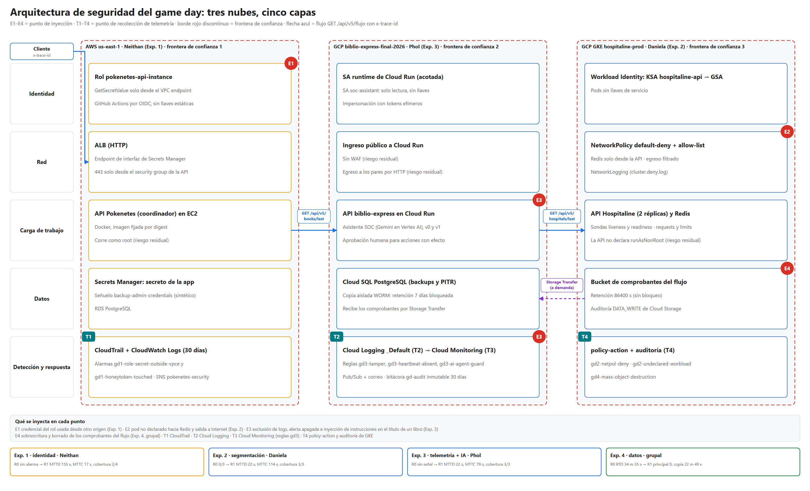
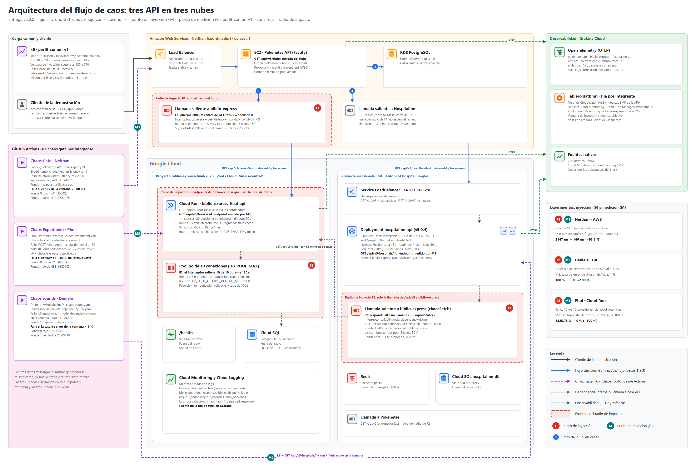
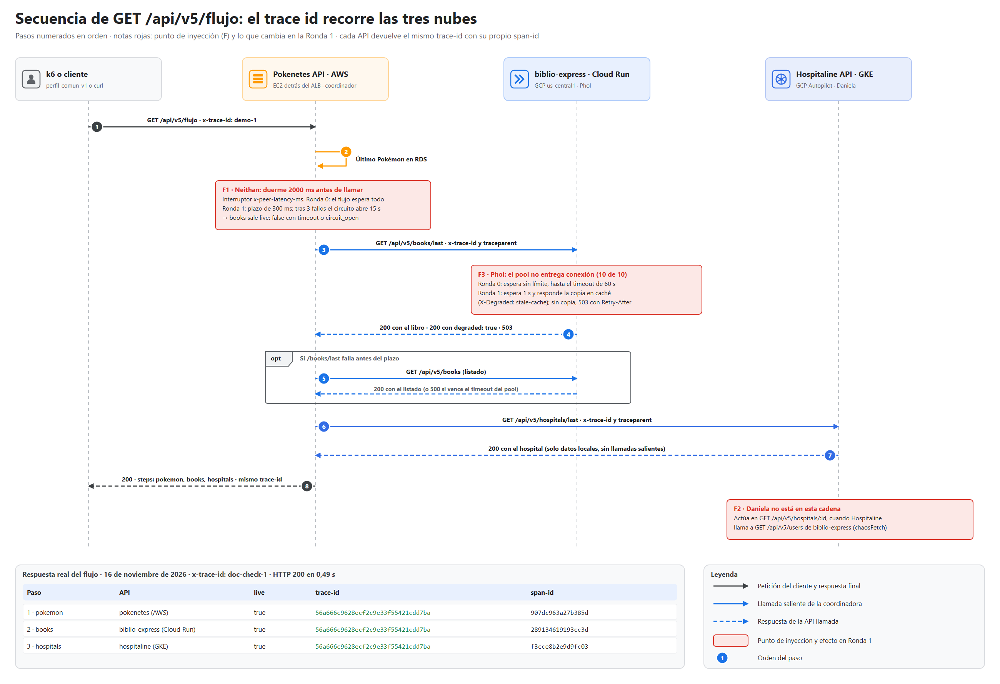
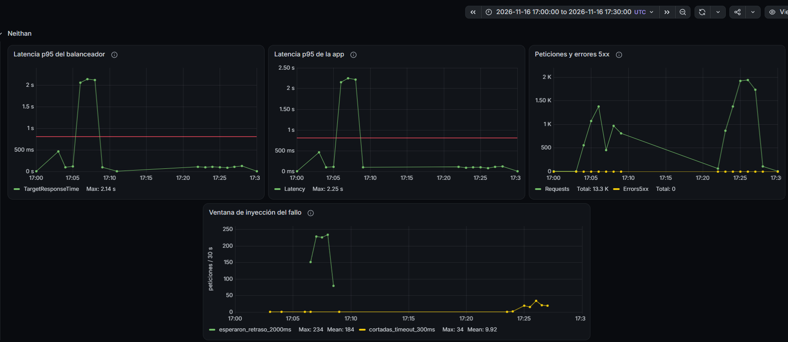
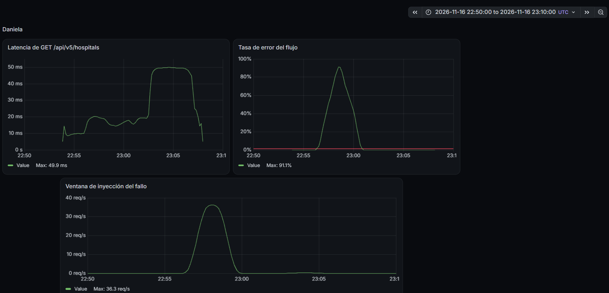
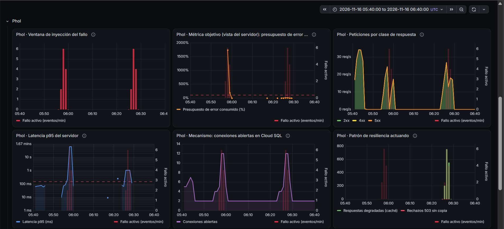
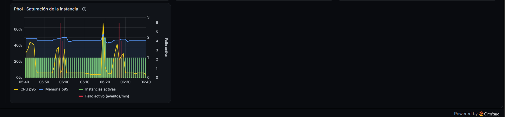
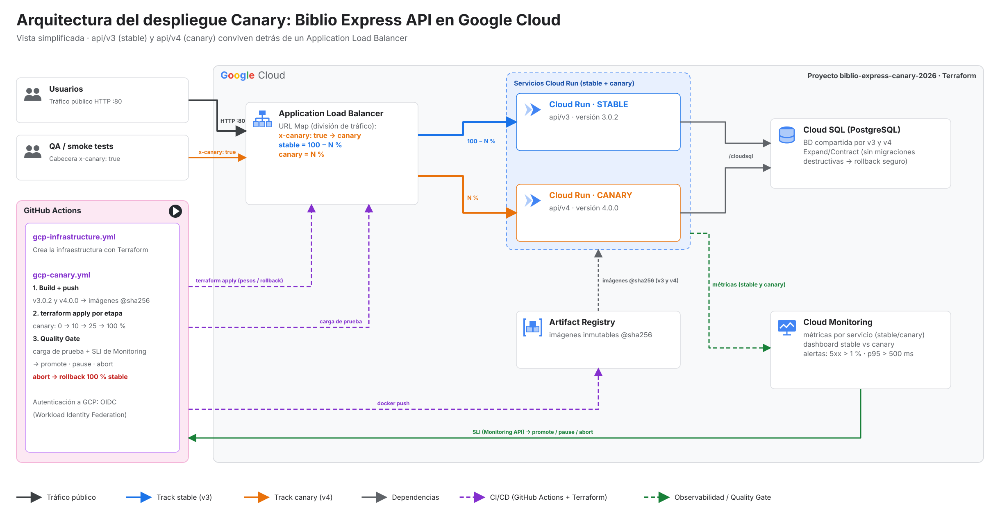
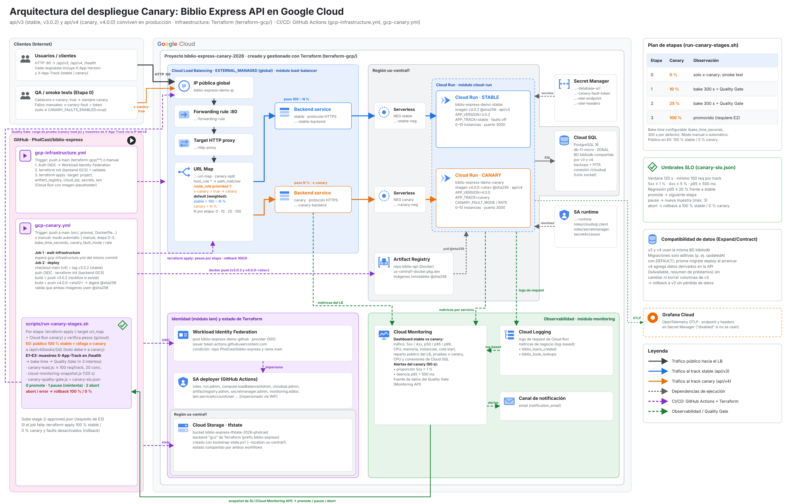
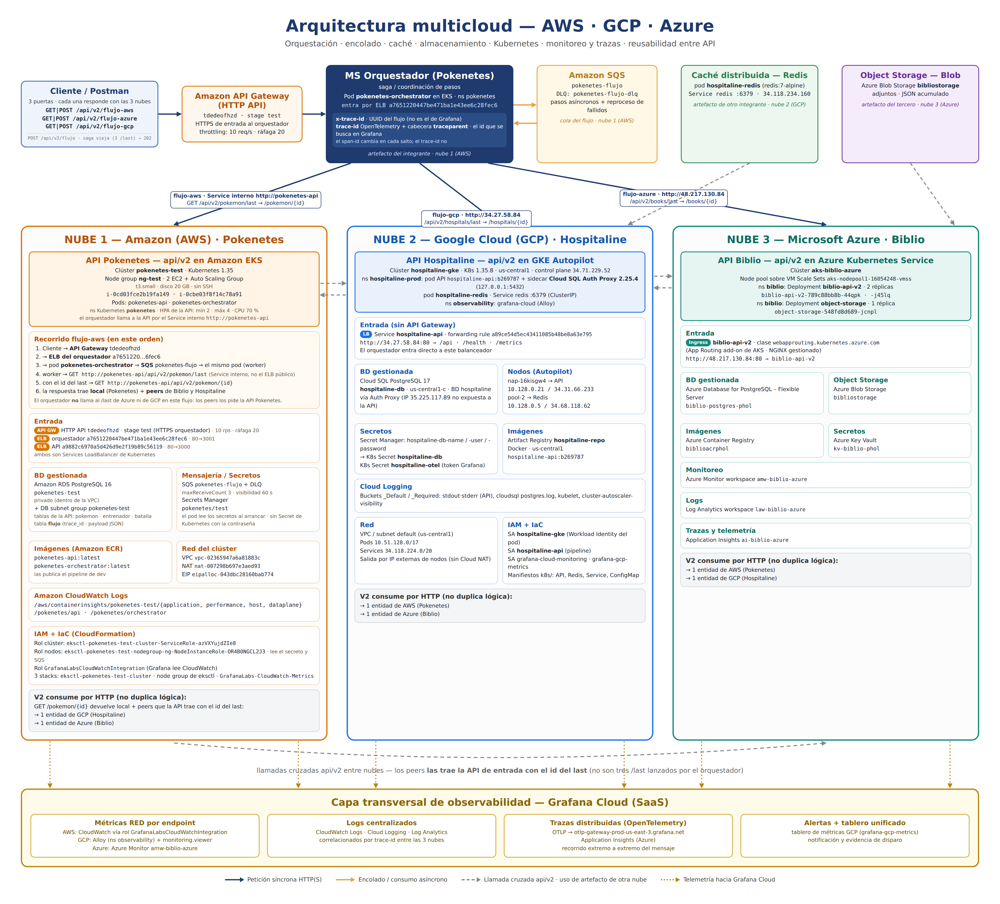

- [Informe DevOps](docs/informe-experimento.pdf)
- [Informe Defensa en Profundidad](docs/informe_defensa_en_profundidad.pdf)

# Biblio Express API

API RESTful para la gestión de una biblioteca, desarrollada con **Node.js**, **Express**, **Prisma ORM**, **PostgreSQL** y **Zod**.

La API administra tres entidades: **Users**, **Books** y **Loans**, e implementa el método HTTP **QUERY** para consultas mediante criterios enviados en el cuerpo de la petición.

# Caos de Seguridad: game day de defensa en profundidad

Game day sobre la misma arquitectura multinube del énfasis de DevOps, para comprobar
**experimentalmente si los controles detectan, contienen y resisten** (aquí la métrica es la eficacia
de los controles, no la velocidad). Cuatro experimentos, dos rondas cada uno: ronda 0 con los
controles tal como estaban y ronda 1 tras las mejoras.

- Informe: [`docs/gameday/informe-gameday.md`](docs/gameday/informe-gameday.md)
- Reglas de compromiso, hipótesis e inventario: [`docs/gameday/`](docs/gameday/)
- Trazabilidad a ISO 27001:2022, NIST 800-53/800-207, ATT&CK, D3FEND y ATLAS: [`docs/gameday/trazabilidad.md`](docs/gameday/trazabilidad.md)
- Experimentos como código de este repositorio: [`security-chaos/`](security-chaos/) (cómo reproducirlos en su README)
- Los otros dos integrantes mantienen sus experimentos en sus repositorios:
  [Pokenetes-API](https://github.com/Enedev/Pokenetes-API) (Neithan, Exp. 1) y
  [HospitalineD](https://github.com/Dhani-dev/HospitalineD) (Daniela, Exp. 2).

## Diagrama por capas

Puntos de inyección **E1–E4**, fronteras de confianza (cada recuadro rojo discontinuo es una nube y un
propietario) y puntos de recolección de telemetría **T1–T4**.



## Trazabilidad control · experimento · marco

Cada control bajo prueba se relaciona con su experimento, la técnica emulada, su contramedida y los marcos de referencia: ISO/IEC 27001:2022 Anexo A, NIST SP 800-53 r5 y NIST SP 800-207 (verificación continua, mínimo privilegio y microsegmentación). IDs verificados en los sitios oficiales el 2026-11-17 (ATT&CK v20.1, ATLAS v2026.10, D3FEND 0.26.1); la versión completa, con nombres exactos y URLs, está en [`docs/gameday/trazabilidad.md`](docs/gameday/trazabilidad.md).

| Exp. | Control | ATT&CK / ATLAS | D3FEND | ISO 27001:2022 A | NIST 800-53 r5 | NIST 800-207 | R0 | R1 |
|---|---|---|---|---|---|---|---|---|
| 1 (Neithan) | Rol `pokenetes-api-instance` y `GetSecretValue` solo vía VPC endpoint | T1552.005 (no detectada), T1078.004 (detectada) | D3-AZET | A.5.15, A.5.16, A.8.2 | AC-3, AC-6, IA-9 | Mínimo privilegio; verificación continua | Refutada. Secreto leído, sin alarma | Cumplida. Lectura denegada a los 17 s; alarma a los 155 s |
| 1 | Lectura de Secrets Manager | T1555.006 (detectada) | D3-AZET | A.5.17, A.8.5 | IA-5, AC-6 | Mínimo privilegio | `GetSecretValue` permitida | Denegada en la pasada medida |
| 1 | Enumeración iam, s3 y ec2 | T1580 (no detectada) | — | A.8.2 | AC-6 | Mínimo privilegio | Denegada | Denegada |
| 1 | Señuelo `backup-admin` | Apoya T1555.006 | D3-DUC | A.5.17 | SC-26 | — | No existía | Lo leyó la pasada previa; alarma a las 01:20:03Z |
| 2 (Daniela) | NetworkPolicy y denegación por defecto en `hospitaline-prod` | T1610, T1046, T1071.001 | D3-NI, D3-ITF, D3-OTF, D3-NTA | A.8.20–A.8.23 | AC-4, SC-7, SC-7(5), CM-7 | Microsegmentación | Refutada. Redis y salida abiertos; cobertura 0/3 | Confirmada. `gd2-netpol-deny` a los 22 s; cobertura 3/3 |
| 3 (Phol) | Logging, alertas y asistente SOC | T1685.002, T1685, AML.T0051.001 | D3-PM | A.8.15, A.8.16, A.8.17, A.5.25, A.5.28 | AU-6, AU-9, AU-12, SI-4 | Verificación continua | Refutada. Sin señal; cobertura 1/3 | Confirmada. `gd3-telemetry-tamper` a los 22 s; cobertura 3/3 |
| 4 (grupal) | Retención del bucket, auditoría `DATA_WRITE` y copia aislada WORM | T1485 | D3-RF, D3-FIM | A.8.13, A.5.29, A.5.30, A.8.10 | CP-9, CP-10, SI-7, SC-28 | Protección del recurso; mínimo privilegio | Refutada. RTO 2075 s (> 30 min); sin alerta | Confirmada. Principal RPO/RTO 0; alerta a los 444 s; copia RTO 1369 s |

**OWASP Top 10 for Agentic Applications 2026 (Exp. 3):** ASI01 Agent Goal Hijack, ASI02 Tool
Misuse, ASI03 Identity & Privilege Abuse.

## Resultados (ronda 0 → ronda 1)

| Exp. | Capa | Responsable | Ronda 0 (controles de hoy) | Ronda 1 (tras las mejoras) |
|---|---|---|---|---|
| 1 | Identidad de máquina | Neithan | Sin alarma; MTTC no contenido | MTTD 155 s, MTTC 17 s; cobertura 2/4 |
| 2 | Exposición y segmentación | Daniela | Sin alerta; cobertura 0/3 | MTTD 22 s, MTTC 114 s; cobertura 3/3 |
| 3 | Telemetría y capa de IA | Phol | Sin señal; cobertura 1/3 | MTTD 22 s, MTTC 79 s; cobertura 3/3 |
| 4 | Resiliencia de datos (grupal) | Los tres | RTO 34 m 35 s, RPO 20 m 33 s; sin alerta | Principal RPO/RTO 0; alerta a 444 s; copia RTO 22 m 49 s |

---

# Ingeniería del Caos: flujo de tres API y experimentos versionados

Entrega `v5.0.0`. Las tres API del grupo forman un flujo síncrono que propaga un identificador de correlación de extremo a extremo, y cada integrante replica un fallo distinto, lo mide, aplica patrones de resiliencia y lo vuelve a medir con la misma carga.

Este repositorio contiene la API **biblio-express** de Phol Castañeda (Google Cloud, Cloud Run), su experimento de **agotamiento de recursos** y el **generador de carga k6 común** que usan los tres integrantes.

| Aspecto | Implementación en este repositorio |
|---|---|
| Nube y cómputo | Google Cloud Platform, Cloud Run (un servicio, una instancia) |
| Base de datos | Cloud SQL para PostgreSQL 16 |
| Infraestructura como código | Terraform en [`terraform-gcp-final/`](terraform-gcp-final/), con el estado remoto en un proyecto distinto |
| Fallo asignado | Agotamiento del pool de conexiones a PostgreSQL |
| Interruptor de fallo propio | [`src/chaos/`](src/chaos/): variable `CHAOS_ENABLED`, cabecera `x-chaos-token` y parámetros `hold` y `durationSeconds` |
| Experimento declarativo | Chaos Toolkit: [`chaos/experiments/pool-exhaustion.yaml`](chaos/experiments/pool-exhaustion.yaml) |
| Generador de carga | k6 con el perfil común: [`load/`](load/) |
| Observabilidad | OpenTelemetry hacia Grafana Cloud, más Cloud Monitoring y Cloud Logging |
| Informe | [`docs/informe-experimento.md`](docs/informe-experimento.md) |
| Análisis con IA | [`docs/analisis-ia.md`](docs/analisis-ia.md): correlación de trazas y métricas, propuestas adoptadas y descartadas |

## Diagrama del flujo, puntos de inyección y medición



Fuente editable: [`docs/diagramas/arquitectura-flujo-caos.svg`](docs/diagramas/arquitectura-flujo-caos.svg).

- **Flujo síncrono (1 a 3):** k6 o un cliente llama a `GET /api/v5/flujo` de Neithan. La coordinadora lee su último Pokémon en RDS y llama en serie a `GET /api/v5/books/last` de biblio-express y a `GET /api/v5/hospitals/last` de Hospitaline. Si `/books/last` falla, intenta una vez el listado `GET /api/v5/books`. Cada llamada tiene un corte de 5 s.
- **Puntos de inyección:**
  - **F1** (Neithan): la coordinadora duerme 2000 ms antes de llamar a biblio-express.
  - **F2** (Daniela): el cliente saliente de Hospitaline responde `503` en lugar de llamar a biblio-express. Actúa en `GET /api/v5/hospitals/:id`, no en la cadena de `/flujo`.
  - **F3** (Phol): el interruptor de biblio-express retiene las 10 conexiones del pool.
- **Frontera del radio de impacto:**
  - **F1:** solo el paso del libro. El Pokémon y el hospital no esperan.
  - **F2:** solo la llamada de `/api/v5` hacia biblio-express. Quedan fuera v1 a v4, la base de datos y la llamada a Pokenetes.
  - **F3:** los endpoints de biblio-express que usan la base de datos. Quedan fuera `/health`, la instancia de Cloud SQL y las otras API, salvo su espera por biblio-express.
- **Dónde se mide:** k6 mide la métrica objetivo de cada integrante en la ventana de inyección (segundos 150 a 270):
  - **M1:** sobre `/api/v5/flujo`.
  - **M2:** sobre `/api/v5/hospitals/:id`.
  - **M3:** directamente sobre `/api/v5/books/1`, para que el resultado no dependa de los fallos ni de las protecciones de las otras API.

  Grafana Cloud reúne las trazas, los logs y la ventana de inyección para el diagnóstico.
- **Trace id:** la cabecera `x-trace-id` y el `traceparent` de W3C viajan en todas las llamadas. Las tres API devuelven el mismo `trace-id` con su propio `span-id`, y en Tempo una sola búsqueda muestra los spans de las tres nubes. biblio-express guarda `x-trace-id` en sus logs y en el atributo `app.x_trace_id` del span.

### Secuencia de `GET /api/v5/flujo`



Fuente editable: [`docs/diagramas/secuencia-flujo.svg`](docs/diagramas/secuencia-flujo.svg).

En la Ronda 1 de Neithan, cuando el plazo o el circuito cortan el paso del libro, la respuesta sigue siendo `200` con `books` en `live: false` y `error: timeout` o `circuit_open`.

## Matriz integrante, fallo, métrica y patrones

| Integrante | Nube | Fallo | Métrica objetivo (instrumento, ventana) | Umbral | Patrones de resiliencia |
|---|---|---|---|---|---|
| Neithan Gómez | AWS: ALB, EC2 y RDS (coordinador) | (a) Latencia: 2000 ms en la llamada saliente a biblio-express | p95 de `GET /api/v5/flujo`: `http_req_duration{phase:fault}` (k6, 120 s) | ≤ 800 ms | Timeout de 300 ms en la llamada al libro y circuit breaker: abre tras 3 fallos y queda abierto 15 s |
| Daniela Higuita | GCP: GKE Autopilot | (b) Indisponibilidad: biblio-express responde `503` en el 100 % de las llamadas salientes | Tasa de error de `GET /api/v5/hospitals/:id`: `http_req_failed{phase:fault}` (k6, 120 s) | ≤ 1 % | Degradación elegante: `200` con `X-Degraded: biblio-express` y el peer en `live: false`. Circuit breaker en memoria de cada pod: abre tras 5 fallos y queda abierto 30 s |
| Phol Castañeda | GCP: Cloud Run y Cloud SQL | (c) Agotamiento de recursos: 10 de 10 conexiones del pool de PostgreSQL | Presupuesto de error consumido en `GET /api/v5/books/:id`, con SLO de 95 %: `http_req_failed{phase:fault}` ÷ 5 % (k6, 120 s) | ≤ 100 % | Timeout de adquisición del pool de 1000 ms. Degradación elegante con caché (`X-Degraded: stale-cache`) |

## Plataforma de inyección de fallos

| Integrante | Archivo declarativo versionado | Herramienta | Interruptor propio | Chaos gate |
|---|---|---|---|---|
| Neithan | [`chaos/neithan-latency.yaml`](https://github.com/Enedev/Pokenetes-API/blob/main/chaos/neithan-latency.yaml) | Especificación propia en YAML, ejecutada por k6 | Cabecera `x-peer-latency-ms` o variable `PEER_LATENCY_MS`. Protecciones: `x-peer-resilience: true` | Workflow `Chaos Gate` ([`chaos-gate.yml`](https://github.com/Enedev/Pokenetes-API/blob/main/.github/workflows/chaos-gate.yml)) |
| Daniela | [`chaos/daniela-dependency-5xx.yaml`](https://github.com/Dhani-dev/HospitalineD/blob/main/chaos/daniela-dependency-5xx.yaml) | Chaos Toolkit | `PUT /chaos/dependency-5xx` (clave en Redis, máximo 900 s) o cabecera `x-fault-mode: dependency-down`. Las rondas usaron la cabecera | Workflow `Chaos rounds` ([`chaos-rounds.yml`](https://github.com/Dhani-dev/HospitalineD/blob/main/.github/workflows/chaos-rounds.yml)) |
| Phol | [`chaos/experiments/pool-exhaustion.yaml`](chaos/experiments/pool-exhaustion.yaml) | Chaos Toolkit | `POST /chaos/pool-exhaustion` con `x-chaos-token`. Reversión automática con tope de 300 s | Workflow `Chaos Experiment` ([`chaos-experiment.yml`](.github/workflows/chaos-experiment.yml)) |

Los tres gates ejecutan el mismo generador ([`load/k6/flow.js`](load/k6/flow.js), fijado en el commit `7b2aef79`) y fallan si la métrica objetivo incumple el umbral. En los de Neithan y Daniela lo decide el umbral de k6; en el de Phol, [`chaos/evaluate_objective.py`](chaos/evaluate_objective.py) a partir del resumen de k6. Las tres Rondas 0 dejaron el job en rojo y las tres Rondas 1 en verde.

## Kubernetes (Hospitaline, Daniela)

| Requisito | Implementación en `hospitaline-prod` (GKE Autopilot `hospitaline-gke`) |
|---|---|
| Réplicas | 2, con `maxUnavailable: 0`, HPA de 2 a 4 réplicas al 70 % de CPU y PodDisruptionBudget con `minAvailable: 1` |
| Probes | Liveness `GET /health` cada 15 s y readiness `GET /health` cada 10 s |
| Recursos | Requests de 250m CPU y 512Mi, y limits de 500m CPU y 1Gi |

Manifiestos en [`k8s/`](https://github.com/Dhani-dev/HospitalineD/tree/main/k8s) del repositorio de Daniela. Chaos Mesh no se usó porque GKE Autopilot no admite su daemon privilegiado.

## Piezas conservadas y retiradas

| Pieza de entregas anteriores | Estado | Motivo |
|---|---|---|
| API completa (`/api` a `/api/v5`), Prisma y PostgreSQL | Se conserva | Es el servicio bajo prueba |
| Cloud Run, Cloud SQL, Secret Manager y Artifact Registry | Se conservan | Recreados en `terraform-gcp-final/` con un solo servicio |
| Workload Identity Federation para GitHub Actions | Se conserva | Despliegue sin llaves de servicio |
| OpenTelemetry hacia Grafana Cloud y `x-trace-id` | Se conservan y se amplían | Métricas del pool, eventos de caos y logs correlacionados |
| Llamadas a doctor y pokémon (`/last` de Daniela y Neithan) | Se conservan | Ahora también en los getById de v5 |
| Endpoints `/last` de v2 | Se conservan | v5 agrega los suyos, con las mismas protecciones del experimento |
| Application Load Balancer y despliegue canary (stable/canary) | Se retiran | Esta entrega no evalúa canary |
| Object Storage, cola y caché transversales | Se retiran del flujo | El enunciado no exige reconstruirlos; el código queda en el repositorio |
| Azure (AKS, ACR) y manifiestos `k8s/` | Se retiran | Kubernetes lo cubre el despliegue de Daniela |
| Workflows anteriores | Desactivados | Movidos a `.github/workflows/past_assignments/`, donde GitHub Actions no los ejecuta |

En las otras nubes del grupo:

| API | Se conserva | Se retira del flujo |
|---|---|---|
| Pokenetes (Neithan, AWS) | API, RDS, balanceador, los dos tracks del canary y el trace id | Cola SQS y API Gateway del despliegue anterior: el flujo es síncrono |
| Hospitaline (Daniela, GCP) | GKE, Cloud SQL `hospitaline-db`, Redis, probes y requests/limits | `bed_capacity` (sigue solo en v4). Cloud Run no atiende este flujo |

## Experimento: agotamiento del pool de conexiones

| Elemento | Valor |
|---|---|
| Hipótesis | Dado el perfil `perfil-comun-v1`, cuando se retengan 10 de las 10 conexiones del pool durante 2 minutos, biblio-express no consumirá más del 100 % de su presupuesto de error (SLO de 95 % de peticiones exitosas en `GET /api/v5/books/:id`) dentro de la ventana de inyección |
| Estado estable | Tasa de éxito ≥ 99 % y latencia p95 ≤ 150 ms con el perfil común. Medido en la calibración del 16 de noviembre de 2026: 100 % de éxito en 3018 peticiones, p95 de 108,4 ms y p99 de 155,0 ms |
| Métrica objetivo | Presupuesto de error consumido en la ventana de inyección: tasa de error (`http_req_failed{phase:fault}`) ÷ 5 % × 100. Umbral ≤ 100 % |
| Instrumento y ventana | k6, 120 s (segundos 150 a 270 del perfil) |
| Recurso e intensidad | Pool `pg` de 10 conexiones (`DB_POOL_MAX`), 10 retenidas (100 %) |
| Duración del fallo | 120 s |
| Condiciones de aborto | `/health` deja de responder 200, o interrupción manual |
| Reversión automática | Temporizador del interruptor, rollbacks de Chaos Toolkit y tope de 300 s |

### Configuración inicial y alcance de Ronda 0

Ronda 0 se ejecuta sin los dos patrones que se evalúan. Las protecciones que ya existían no se tocan.

| Protección | Ronda 0 | Ronda 1 |
|---|---|---|
| Timeout de petición de Cloud Run (60 s) | Activa (ya existía) | Activa |
| `/health` sin acceso a base de datos y probes | Activa (ya existía) | Activa |
| Instancia mínima caliente | Activa (ya existía) | Activa |
| `Promise.allSettled` en las llamadas a doctor y pokémon | Activa (ya existía) | Activa |
| Timeout de adquisición del pool (`DB_POOL_ACQUIRE_TIMEOUT_MS`) | **0, sin límite** | **1000 ms** |
| Caché de respaldo (`STALE_CACHE_ENABLED`) | **Desactivada** | **Activada** |

Ambas rondas usan la misma imagen. Solo cambia la variable `resilience_enabled` de Terraform.

### Patrones de resiliencia

1. **Timeout por dependencia.** El pool deja de esperar una conexión a los 1000 ms. Sin este límite, cada petición queda colgada hasta que el cliente desiste, y las peticiones en espera se acumulan.
2. **Degradación elegante con caché (stale-if-error).** Cada getById y cada `/last` de v5 guarda su última respuesta correcta. Si la base de datos no responde, devuelve esa copia con `"degraded": true` y la cabecera `X-Degraded: stale-cache`. Sin copia disponible responde `503` con `Retry-After`.

Código: [`src/config/db-pool.js`](src/config/db-pool.js) y [`src/resilience/`](src/resilience/).

### Resultados

| Ronda | Presupuesto de error consumido | Tasa de error en la ventana | Hipótesis |
|---|---|---|---|
| Ronda 0 (sin protección) | 1825,73 % | 91,29 % (220 de 241 peticiones) | Refutada |
| Ronda 1 (protegida) | 0 % | 0 % (1507 peticiones, todas servidas desde la caché) | Cumplida |
| Variación | −100 % | −100 % | |

Medido el 16 de noviembre de 2026 con `perfil-comun-v1` desde GitHub Actions: calibración ([43811651498](https://github.com/PholCast/biblio-express/actions/runs/43811651498)), Ronda 0 en rojo ([43813169074](https://github.com/PholCast/biblio-express/actions/runs/43813169074)) y Ronda 1 en verde ([43816365165](https://github.com/PholCast/biblio-express/actions/runs/43816365165)). En la Ronda 0 el p95 en la ventana fue de 10 001 ms (timeout de k6) y en la Ronda 1 de 1118 ms: cada petición espera el timeout de adquisición de 1 s y recibe la copia en caché.

El análisis completo está en [`docs/informe-experimento.md`](docs/informe-experimento.md).

## Instrumentación

| Señal | Nombre | Qué muestra |
|---|---|---|
| Métrica | `biblio.db.pool.total`, `.idle`, `.waiting`, `.max` | Estado del pool; `waiting` crece cuando el pool se agota |
| Métrica | `biblio.chaos.active`, `biblio.chaos.held_connections` | Ventana exacta de inyección |
| Métrica | `biblio.resilience.events{pattern}` | Veces que actuó cada patrón |
| Métrica | `biblio.external.request.duration{dependency,outcome}` | Duración y resultado de las llamadas salientes |
| Métrica | `biblio.http.request.duration`, `biblio.http.errors.5xx` | Latencia y errores por ruta (ya existían) |
| Métrica | `biblio.runtime.eventloop.delay.p99` | Saturación del proceso Node.js |
| Log | `chaos_fault_started`, `chaos_fault_active`, `chaos_fault_stopped` | Inicio, latido cada 10 s y fin del fallo |
| Log | `degraded_response`, `db_unavailable`, `external_call` | Respuesta degradada, rechazo 503 y llamada saliente |
| Traza | Span HTTP con el atributo `app.x_trace_id` | Búsqueda de la traza por el identificador del flujo |

Los logs llevan `x_trace_id`, `trace_id` y `span_id`. Se envían a Grafana Cloud por OpenTelemetry y a Cloud Logging en formato JSON. El tablero de Cloud Monitoring (`biblio-express-final-chaos-dashboard`) se define en [`terraform-gcp-final/modules/monitoring/`](terraform-gcp-final/modules/monitoring/). El tablero conjunto de Grafana Cloud tiene una fila por integrante, con la ventana de inyección y la métrica objetivo de sus dos rondas. La fila de Phol lee el datasource de Cloud Monitoring de este proyecto; ningún valor está escrito a mano.

| Fila | Rango con las dos rondas (UTC, 16 de noviembre de 2026) |
|---|---|
| Neithan | [17:00 a 17:30](https://vibrantkinkajou470.grafana.net/d/datbmrl/caos-del-grupo-e28094-tres-nubes?from=2026-11-16T17:00:00.000Z&to=2026-11-16T17:30:00.000Z&timezone=utc) |
| Daniela | [22:50 a 23:10](https://vibrantkinkajou470.grafana.net/d/datbmrl/caos-del-grupo-e28094-tres-nubes?from=2026-11-16T22:50:00.000Z&to=2026-11-16T23:10:00.000Z&timezone=utc) |
| Phol | [05:40 a 06:40](https://vibrantkinkajou470.grafana.net/d/datbmrl/caos-del-grupo-e28094-tres-nubes?from=2026-11-16T05:40:00.000Z&to=2026-11-16T06:40:00.000Z&timezone=utc) |

Fila de Neithan con las dos rondas, de 17:00 a 17:30 UTC. La Ronda 0 sube el p95 a unos 2 s entre 17:06 y 17:08; en la Ronda 1 el p95 se queda bajo la línea roja de 800 ms.



Fila de Daniela con las dos rondas, de 22:50 a 23:10 UTC. En la Ronda 0 la tasa de error del flujo llega al 91 %; en la Ronda 1 se queda en 0 %.



Fila de Phol con las dos rondas: las barras rojas marcan la ventana de inyección en cada panel.





Las horas de Cloud Logging están en UTC.

## API v5

`/api/v5` conserva todas las operaciones de las versiones anteriores. Los tres getById devuelven además un doctor y un pokémon obtenidos de las API de los compañeros (`/api/v5/doctors/last` de Daniela y `/api/v5/pokemon/last` de Neithan), sin Object Storage.

| Endpoint | Respuesta |
|---|---|
| `GET /api/v5/books/:id` | `book`, `availability`, `pokemon`, `doctor` |
| `GET /api/v5/users/:id` | `user`, `loans`, `pokemon`, `doctor` |
| `GET /api/v5/loans/:id` | `loan`, `pokemon`, `doctor` |
| `GET /api/v5/books/last` | `book`: el último libro creado. Es la entidad que invoca la API coordinadora |
| `GET /api/v5/users/last` | `user`: el último usuario creado |
| `GET /api/v5/loans/last` | `loan`: el último préstamo creado |

Si una API externa falla o no está configurada (`DOCTORS_API_URL`, `POKEMON_API_URL`), su campo llega en `null` y la respuesta sigue siendo `200`. Los `/last` no llaman a otras API, así que el flujo de la coordinadora no forma un ciclo.

Con las protecciones activas, los getById y los `/last` responden con la última copia correcta (`"degraded": true`) si la base de datos no atiende, o con `503` y `Retry-After` si no hay copia.

## Infraestructura final en GCP

[`terraform-gcp-final/`](terraform-gcp-final/) mantiene la estructura de `terraform-gcp/` sin balanceador, sin canary y sin Kubernetes.

| Módulo | Recursos |
|---|---|
| `project` | Proyecto (opcional) y API requeridas |
| `artifact-registry` | Repositorio Docker `biblio-api` |
| `cloud-sql` | PostgreSQL 16, base `bibliodb` y usuario `biblioapp` |
| `secrets` | `database-url`, `chaos-token`, `otel-endpoint`, `otel-headers` |
| `iam` | Cuentas de servicio y Workload Identity Federation |
| `cloud-run` | Un servicio con límites de CPU y memoria, probes y una instancia fija |
| `monitoring` | Tablero, alertas y métricas basadas en logs |

**El estado de Terraform vive fuera del proyecto de la aplicación.** `bootstrap-state.ps1` crea el bucket en un proyecto distinto, y `destroy.ps1` se niega a continuar si el bucket pertenece al proyecto que va a destruir.

```powershell
cd terraform-gcp-final
.\bootstrap-state.ps1 -AppProjectId <proyecto-app> -StateProjectId <proyecto-estado> -BucketName <bucket>
Copy-Item terraform.tfvars.example terraform.tfvars
.\preflight.ps1
terraform init -backend-config=backend.hcl
terraform apply -var-file=terraform.tfvars
```

Para eliminar todo: `.\destroy.ps1`.

## CI/CD

| Workflow | Disparo | Qué hace |
|---|---|---|
| [`gcp-final.yml`](.github/workflows/gcp-final.yml) | Push a `main` o manual | Construye la imagen, la publica por digest, aplica `terraform-gcp-final` y hace una prueba de humo |
| [`chaos-experiment.yml`](.github/workflows/chaos-experiment.yml) | Manual | Ejecuta una ronda y falla si la métrica objetivo incumple el umbral; guarda las evidencias |

`chaos-experiment.yml` es la **puerta de calidad (chaos gate)** de este experimento: ejecuta Chaos Toolkit y k6 desde un runner de GitHub y el job falla si el presupuesto de error consumido en la ventana supera el 100 % (más de 5 % de errores). En Ronda 0 el fallo del job es el resultado esperado, y el resumen de la ejecución muestra la métrica medida, el umbral y el veredicto. Necesita:

| Tipo | Nombre | Valor |
|---|---|---|
| Variable | `GCP_FINAL_SERVICE_URL` | `terraform output -raw service_url` |
| Secreto | `GCP_FINAL_CHAOS_TOKEN` | El `chaos_token` de `terraform.tfvars` |
| Secreto | `K6_PROMETHEUS_RW_SERVER_URL`, `K6_PROMETHEUS_RW_USERNAME`, `K6_PROMETHEUS_RW_PASSWORD` | Opcionales: envían las métricas de k6 a Grafana Cloud para ver la métrica objetivo en el tablero ([`load/README.md`](load/README.md)) |

`gcp-final.yml` se omite sin fallar mientras no existan sus variables y secretos:

| Tipo | Nombre |
|---|---|
| Variable | `GCP_FINAL_PROJECT_ID`, `GCP_FINAL_STATE_PROJECT_ID`, `GCP_FINAL_TF_STATE_BUCKET` |
| Variable | `DOCTORS_API_URL`, `POKEMON_API_URL`, `GCP_FINAL_RESILIENCE_ENABLED`, `GCP_FINAL_CHAOS_ENABLED` |
| Secreto | `GCP_FINAL_WORKLOAD_IDENTITY_PROVIDER`, `GCP_FINAL_DEPLOYER_SERVICE_ACCOUNT`, `GCP_FINAL_CHAOS_TOKEN` |
| Secreto | `OTEL_EXPORTER_ENDPOINT`, `OTEL_EXPORTER_HEADERS` |

`GCP_FINAL_WORKLOAD_IDENTITY_PROVIDER` y `GCP_FINAL_DEPLOYER_SERVICE_ACCOUNT` salen de `terraform output`. Las demás deben coincidir con `terraform.tfvars`, para que un despliegue desde el pipeline no cambie la configuración de las rondas.

## Cómo reproducir las rondas

1. Desplegar con `resilience_enabled = false` y `chaos_enabled = true`.
2. Crear los datos sintéticos: `node scripts/seed-synthetic-data.js <url>`.
3. Probar la reversión del interruptor ([`chaos/README.md`](chaos/README.md)).
4. Medir el estado estable: workflow **Chaos Experiment** con `round = calibracion`.
5. Ronda 0: el mismo workflow con `round = 0`.
6. Desplegar con `resilience_enabled = true`.
7. Ronda 1: el mismo workflow con `round = 1`.

Las tres ejecuciones se hacen desde el mismo lugar, para que el instrumento de medición sea el mismo. Desde un equipo propio sirven `.\scripts\chaos\run-round.ps1 -Round <calibracion|0|1> -BaseUrl <url>` o `scripts/chaos/run-round.sh`. Entre la calibración y la Ronda 1 no cambian la imagen, las URL de las API externas ni sus datos.

El perfil de carga se documenta en [`load/README.md`](load/README.md).

## Demostración en vivo

Antes de empezar, calentar la caché de la revisión activa con `GET /api/v5/books/1` y `GET /api/v5/books/last`. El token del interruptor se toma de `terraform.tfvars` y no se muestra en pantalla.

| Paso | Qué se muestra | Cómo |
|---|---|---|
| (a) Flujo en las tres nubes | La misma traza en AWS, Cloud Run y GKE | `curl -H "x-trace-id: demo-1" http://pokenetes-alb-1190353326.us-east-1.elb.amazonaws.com/api/v5/flujo`. Los tres `steps` devuelven el mismo `trace-id`, que se busca en Tempo |
| (b) Experimento declarativo | Chaos Toolkit inyecta el fallo real | Workflow **Chaos Experiment** con `round = 1`, o `chaos run chaos/experiments/pool-exhaustion.yaml` |
| (c) Comparación de rondas | Ventana de inyección y métrica objetivo de las dos rondas | Tablero de Grafana Cloud con los rangos de [Instrumentación](#instrumentación) |
| (d) Patrón actuando | Respuesta degradada | Durante el fallo, `curl -i <url>/api/v5/books/1` responde `200` con `X-Degraded: stale-cache` y `"degraded": true` |
| (e) Reversión | Vuelta al estado estable | `GET /chaos/status` muestra el fallo apagado y `GET /api/v5/books/1` responde sin `degraded` |

Patrones de los compañeros, para la misma demostración:

- **Neithan:** `GET /api/v5/flujo` con `x-peer-latency-ms: 2000` y `x-peer-resilience: true` responde en menos de 1 s, con `books` en `live: false` y `error: timeout`. Tras tres peticiones, `error: circuit_open`.
- **Daniela:** `GET /api/v5/hospitals/:id` con `x-fault-mode: dependency-down` y `x-peer-resilience: true` responde `200` con `X-Degraded: biblio-express`. Sin la segunda cabecera responde `503`.


# Documentación general de la API

## Tecnologías

- Node.js 24
- Express 5
- Prisma 7
- PostgreSQL / Supabase / Cloud SQL
- Zod 4
- Vitest
- Docker
- GitHub Actions
- pnpm 11
- Google Cloud: Cloud Run, Cloud Load Balancing, Cloud SQL, Artifact Registry, Secret Manager, Cloud Monitoring y Cloud Logging
- Terraform
- OpenTelemetry y Grafana Cloud

## Requisitos

- Node.js 24+
- pnpm 11+
- PostgreSQL/Supabase
- Git

## Instalación

```bash
git clone <REPOSITORY_URL>
cd biblio-express
pnpm install
```

Crear `.env` a partir de `.env.example`:

```env
PORT=3000
DATABASE_URL=postgresql://...
```

Generar Prisma Client:

```bash
pnpm exec prisma generate
```

## Ejecución local

Desarrollo:

```bash
pnpm run dev
```

Producción/local normal:

```bash
pnpm start
```

Con `PORT=3000`, la aplicación queda disponible en `http://localhost:3000`.

## Variables de entorno

| Variable | Descripción |
|---|---|
| `PORT` | Puerto del servidor |
| `DATABASE_URL` | URL de conexión a PostgreSQL |
| `APP_VERSION` | Versión desplegada que se devuelve en `X-App-Version` (p. ej. `3.0.2` o `4.0.0`) |
| `APP_TRACK` | Track que atiende la petición, devuelto en `X-App-Track` (`stable` o `canary`) |
| `CANARY_FAULTS_ENABLED` | Habilita la inyección de fallos; solo tiene efecto con `APP_TRACK=canary` |
| `CANARY_FAULT_MODE` | Regresión simulada: `none`, `error` (HTTP 500) o `latency` |
| `CANARY_FAULT_RATE` | Porcentaje de peticiones `/api` del canary afectadas (por defecto `25`) |
| `CANARY_FAULT_LATENCY_MS` | Retraso inyectado en el modo `latency` (por defecto `2000`) |
| `CANARY_FAULT_TOKEN` | Token requerido para la inyección manual con la cabecera `x-canary-fault` |
| `DOCTORS_API_URL`, `POKEMON_API_URL` | URL base de las API de los compañeros (endpoints `/last`). Vacías: la integración se desactiva |
| `DB_POOL_MAX` | Tamaño máximo del pool de conexiones a PostgreSQL (por defecto `10`) |
| `DB_POOL_ACQUIRE_TIMEOUT_MS` | Tiempo máximo esperando una conexión del pool. `0` = sin límite (Ronda 0); `1000` en Ronda 1 |
| `STALE_CACHE_ENABLED`, `STALE_CACHE_TTL_SECONDS` | Caché de respaldo de los getById y `/last` de v5 y edad máxima de la copia (por defecto `300` s) |
| `CHAOS_ENABLED` | Habilita las rutas `/chaos` del interruptor de fallos |
| `CHAOS_TOKEN` | Token requerido en la cabecera `x-chaos-token` |
| `OTEL_SERVICE_NAME`, `OTEL_EXPORTER_OTLP_ENDPOINT`, `OTEL_EXPORTER_OTLP_HEADERS` | Exportación OpenTelemetry hacia Grafana Cloud |

En Cloud Run, Terraform define estas variables (salvo `PORT`, que la asigna Cloud Run automáticamente) y toma los valores sensibles de Secret Manager.

El archivo `.env` no debe subirse al repositorio. `.env.example` sirve como referencia.

## 🗃️ Modelos de base de datos

La aplicación utiliza PostgreSQL mediante Prisma ORM. La base de datos está compuesta por tres tablas principales: `User`, `Book` y `Loan`.

### User

| Campo | Tipo | Restricciones | Descripción |
|---|---|---|---|
| `id` | `Int` | PK, autoincremental | Identificador único del usuario |
| `name` | `String` | Obligatorio | Nombre del usuario |
| `email` | `String` | Obligatorio, único | Correo electrónico del usuario |
| `createdAt` | `DateTime` | Obligatorio, valor por defecto `now()` | Fecha y hora de creación del usuario |
| `updatedAt` | `DateTime` | Obligatorio, se actualiza automáticamente | Fecha y hora de la última modificación |

---

### Book

| Campo | Tipo | Restricciones | Descripción |
|---|---|---|---|
| `id` | `Int` | PK, autoincremental | Identificador único del libro |
| `title` | `String` | Obligatorio | Título del libro |
| `author` | `String` | Obligatorio | Autor del libro |
| `isbn` | `String` | Obligatorio, único | ISBN del libro |
| `publishedAt` | `DateTime` | Obligatorio | Fecha de publicación del libro |
| `updatedAt` | `DateTime` | Obligatorio, se actualiza automáticamente | Fecha y hora de la última modificación |

---

### Loan

| Campo | Tipo | Restricciones | Descripción |
|---|---|---|---|
| `id` | `Int` | PK, autoincremental | Identificador único del préstamo |
| `userId` | `Int` | FK → `User.id` | Identificador del usuario que realiza el préstamo |
| `bookId` | `Int` | FK → `Book.id` | Identificador del libro asociado al préstamo |
| `borrowedAt` | `DateTime` | Obligatorio, valor por defecto `now()` | Fecha y hora en que se realiza el préstamo |
| `dueDate` | `DateTime` | Obligatorio | Fecha límite de devolución |
| `returnedAt` | `DateTime` | Opcional / nullable | Fecha y hora de devolución del libro |
| `updatedAt` | `DateTime` | Obligatorio, se actualiza automáticamente | Fecha y hora de la última modificación |

---

### Relaciones

```text
User 1 ───────── N Loan N ───────── 1 Book
```

- Un `User` puede tener múltiples `Loan`.
- Un `Book` puede estar asociado a múltiples `Loan`.
- Cada `Loan` pertenece a un `User`.
- Cada `Loan` pertenece a un `Book`.

El modelo está definido en `prisma/schema.prisma`.

### Restricciones principales

- `User.id` es la clave primaria y se genera automáticamente.
- `User.email` debe ser único.
- `Book.id` es la clave primaria y se genera automáticamente.
- `Book.isbn` debe ser único.
- `Loan.id` es la clave primaria y se genera automáticamente.
- `Loan.userId` referencia a `User.id`.
- `Loan.bookId` referencia a `Book.id`.
- `Loan.returnedAt` puede ser `NULL` mientras el préstamo no haya sido devuelto.

# Comandos disponibles

| Comando | Descripción |
|---|---|
| `pnpm install` | Instala dependencias |
| `pnpm run dev` | Servidor en desarrollo |
| `pnpm start` | Ejecuta el servidor |
| `pnpm test` | Ejecuta Vitest |
| `pnpm test:run` | Ejecuta pruebas una vez |
| `pnpm test:coverage` | Pruebas con cobertura |
| `pnpm exec prisma generate` | Genera Prisma Client |


## Health Check

### `GET /health`

Respuesta (incluye la versión y el track que atendió la petición, también en las cabeceras `X-App-Version` y `X-App-Track`):

```json
{
  "status": "ok",
  "appVersion": "4.0.0",
  "track": "canary"
}
```

## API

Todas las rutas principales utilizan el prefijo `/api`.

- `/api/users`
- `/api/books`
- `/api/loans`


# 📌 Endpoints disponibles

| Método | Endpoint | Descripción |
|---|---|---|
| `GET` | `/health` | Health check |
| `POST` | `/api/users` | Crear usuario |
| `GET` | `/api/users` | Obtener usuarios |
| `GET` | `/api/users/:id` | Obtener usuario |
| `PUT` | `/api/users/:id` | Actualizar usuario |
| `PATCH` | `/api/users/:id` | Actualizar parcialmente usuario |
| `DELETE` | `/api/users/:id` | Eliminar usuario |
| `QUERY` | `/api/users` | Consultar usuarios |
| `POST` | `/api/books` | Crear libro |
| `GET` | `/api/books` | Obtener libros |
| `GET` | `/api/books/:id` | Obtener libro |
| `PUT` | `/api/books/:id` | Actualizar libro |
| `PATCH` | `/api/books/:id` | Actualizar parcialmente libro |
| `DELETE` | `/api/books/:id` | Eliminar libro |
| `QUERY` | `/api/books` | Consultar libros |
| `POST` | `/api/loans` | Crear préstamo |
| `GET` | `/api/loans` | Obtener préstamos |
| `GET` | `/api/loans/:id` | Obtener préstamo |
| `PUT` | `/api/loans/:id` | Actualizar préstamo |
| `PATCH` | `/api/loans/:id` | Actualizar parcialmente préstamo |
| `DELETE` | `/api/loans/:id` | Eliminar préstamo |
| `QUERY` | `/api/loans` | Consultar préstamos |

## API V2

La versión V2 está disponible bajo el prefijo `/api/v2` y conserva todos los endpoints de la V1 para usuarios, libros y préstamos, usando la misma operación con el prefijo V2. Además, agrega los endpoints `last` y `:id` con respuestas enriquecidas, metadatos de versión y trazabilidad.

Por tanto, cada entidad conserva en V2 los endpoints de la V1:

| Método | Endpoint V2 | Descripción |
|---|---|---|
| `POST` | `/api/v2/users`, `/api/v2/books`, `/api/v2/loans` | Crear un recurso |
| `GET` | `/api/v2/users`, `/api/v2/books`, `/api/v2/loans` | Obtener la colección |
| `PUT` | `/api/v2/users/:id`, `/api/v2/books/:id`, `/api/v2/loans/:id` | Actualizar un recurso completo |
| `PATCH` | `/api/v2/users/:id`, `/api/v2/books/:id`, `/api/v2/loans/:id` | Actualizar parcialmente un recurso |
| `DELETE` | `/api/v2/users/:id`, `/api/v2/books/:id`, `/api/v2/loans/:id` | Eliminar un recurso |
| `QUERY` | `/api/v2/users`, `/api/v2/books`, `/api/v2/loans` | Consultar por criterios |

Además, para cada entidad V2 agrega:

| Método | Endpoint | Descripción |
|---|---|---|
| `GET` | `/api/v2/users/last` | Obtiene el usuario creado más recientemente |
| `GET` | `/api/v2/users/:id` | Obtiene un usuario por ID junto con un Pokémon y un doctor externos |
| `GET` | `/api/v2/books/last` | Obtiene el libro creado más recientemente |
| `GET` | `/api/v2/books/:id` | Obtiene un libro por ID junto con un Pokémon y un doctor externos |
| `GET` | `/api/v2/loans/last` | Obtiene el préstamo creado más recientemente |
| `GET` | `/api/v2/loans/:id` | Obtiene un préstamo por ID junto con un Pokémon y un doctor externos |

Los endpoints `GET /api/v2/:entity/:id` construyen una respuesta con la entidad solicitada, los datos de Pokémon y doctor, y metadatos de trazabilidad. Antes de responder, la API envía el artefacto completo a `POST /artifacts` del microservicio Object Storage. El nombre del blob sigue el formato `entity/id-traceId.json`. Si Object Storage no está disponible, la API registra el error y conserva la respuesta de negocio.

Los endpoints `GET /api/v2/:entity/last` devuelven el registro más reciente con los metadatos V2. En la implementación actual no envían un artefacto al Object Storage.

Ejemplos:

```text
GET /api/v2/users/last
GET /api/v2/users/1
GET /api/v2/books/last
GET /api/v2/books/1
GET /api/v2/loans/last
GET /api/v2/loans/1
```

Las respuestas V2 incluyen, cuando están disponibles, `api`, `version`, `x-trace_id`, `trace-id` y `span-id`. Los endpoints `last` devuelven el registro más reciente y los endpoints por ID agregan un Pokémon y un doctor obtenidos de servicios externos. Estos últimos pueden responder `404` si la entidad no existe o `500` si falla la consulta de datos externos.


# Users

## `POST /api/users`

Crea un usuario.

```json
{
  "name": "John Doe",
  "email": "john@example.com"
}
```

Respuesta: `201 Created`.

El email debe ser válido y único. Si ya existe, devuelve `409 Conflict`:

```json
{
  "message": "User with this email already exists"
}
```

## `GET /api/users`

Obtiene todos los usuarios.

Respuesta: `200 OK`.

## `GET /api/users/:id`

Obtiene un usuario por ID. Si no existe devuelve `404 Not Found`:

```json
{
  "message": "User not found"
}
```

## `PUT /api/users/:id`

Actualiza completamente un usuario. Requiere `name` y `email`.

```json
{
  "name": "Updated User",
  "email": "updated@example.com"
}
```

Respuesta: `200 OK`. Un email perteneciente a otro usuario produce `409 Conflict`.

## `PATCH /api/users/:id`

Actualiza parcialmente un usuario. Debe enviarse al menos un campo.

```json
{
  "name": "New Name"
}
```

Respuesta: `200 OK`.

## `DELETE /api/users/:id`

Elimina un usuario. Respuesta exitosa: `204 No Content`.

Un usuario con préstamos asociados no puede eliminarse y devuelve `409 Conflict`.

## `QUERY /api/users`

Consulta usuarios mediante criterios en el body. Criterios disponibles: `id`, `name`, `email`, `createdAt`.

```json
{
  "name": "John Doe",
  "email": "john@example.com"
}
```

Debe existir al menos un criterio. Respuesta: `200 OK`.

# Books

## `POST /api/books`

Crea un libro.

```json
{
  "title": "Clean Code",
  "author": "Robert C. Martin",
  "isbn": "9780132350884",
  "publishedAt": "2008-08-01"
}
```

Respuesta: `201 Created`. El ISBN debe ser único.

## `GET /api/books`

Obtiene todos los libros. Respuesta: `200 OK`.

## `GET /api/books/:id`

Obtiene un libro por ID. Si no existe devuelve `404 Not Found`.

## `PUT /api/books/:id`

Actualiza completamente un libro.

```json
{
  "title": "Clean Code 2",
  "author": "Robert C. Martin",
  "isbn": "9780132350884",
  "publishedAt": "2008-08-01"
}
```

Respuesta: `200 OK`.

## `PATCH /api/books/:id`

Actualiza parcialmente un libro.

```json
{
  "title": "Clean Code - Updated"
}
```

Debe enviarse al menos un campo. Respuesta: `200 OK`.

## `DELETE /api/books/:id`

Elimina un libro. Respuesta exitosa: `204 No Content`.

Un libro asociado a préstamos no puede eliminarse.

## `QUERY /api/books`

Criterios disponibles: `id`, `title`, `author`, `isbn`, `publishedAt`.

```json
{
  "author": "Robert C. Martin",
  "title": "Clean Code"
}
```

Debe existir al menos un criterio.

# Loans

Los préstamos relacionan un usuario con un libro y contienen fechas de préstamo, vencimiento y devolución.

## `POST /api/loans`

Crea un préstamo.

```json
{
  "userId": 1,
  "bookId": 1,
  "dueDate": "2026-08-25T00:00:00.000Z"
}
```

`borrowedAt` es opcional y se genera automáticamente. `returnedAt` es opcional y por defecto es `null`.

También puede enviarse el objeto completo:

```json
{
  "userId": 1,
  "bookId": 1,
  "borrowedAt": "2026-08-18T15:00:00.000Z",
  "dueDate": "2026-08-25T15:00:00.000Z",
  "returnedAt": null
}
```

Las fechas deben respetar las reglas de validación de préstamos.

## `GET /api/loans`

Obtiene todos los préstamos. Respuesta: `200 OK`.

## `GET /api/loans/:id`

Obtiene un préstamo por ID. Si no existe devuelve `404 Not Found`.

## `PUT /api/loans/:id`

Actualiza completamente un préstamo.

```json
{
  "userId": 1,
  "bookId": 1,
  "borrowedAt": "2026-08-18T15:00:00.000Z",
  "dueDate": "2026-08-25T15:00:00.000Z",
  "returnedAt": null
}
```

## `PATCH /api/loans/:id`

Actualiza parcialmente un préstamo.

```json
{
  "returnedAt": "2026-08-20T15:00:00.000Z"
}
```

## `DELETE /api/loans/:id`

Elimina un préstamo. Respuesta exitosa: `204 No Content`.

## `QUERY /api/loans`

Criterios disponibles: `id`, `userId`, `bookId`, `borrowedAt`, `dueDate`, `returnedAt`.

```json
{
  "userId": 1,
  "bookId": 1
}
```

Debe existir al menos un criterio.

# Validación

Las peticiones se validan con **Zod** mediante `src/middlewares/validate.js`.

Schemas por módulo:

```text
src/modules/users/user.schema.js
src/modules/books/book.schema.js
src/modules/loans/loan.schema.js
```

Se validan, entre otros:

- Campos obligatorios.
- Strings no vacíos.
- Emails válidos.
- IDs enteros positivos.
- Fechas válidas.
- Criterios QUERY.
- PATCH con al menos un campo.
- Coherencia de fechas de préstamos.

# Códigos HTTP

| Código | Significado |
|---|---|
| `200` | Operación exitosa |
| `201` | Recurso creado |
| `204` | Recurso eliminado correctamente |
| `404` | Recurso no encontrado |
| `409` | Conflicto con el estado actual del recurso |
| `500` | Error interno del servidor |

# Arquitectura

La aplicación separa responsabilidades por módulos:

```text
Routes
   ↓
Validation Middleware
   ↓
Controller
   ↓
Service
   ↓
Prisma
   ↓
PostgreSQL
```

- **Routes:** definen endpoints y conectan middleware/controllers.
- **Schemas:** contienen las reglas de validación Zod.
- **Controllers:** gestionan HTTP, códigos de estado y respuestas.
- **Services:** contienen acceso a datos y lógica de negocio.
- **Prisma:** proporciona acceso ORM a PostgreSQL.

# Pruebas

El proyecto utiliza Vitest.

```bash
pnpm test
```

Ejecutar una sola vez:

```bash
pnpm test:run
```

Ejecutar con cobertura:

```bash
pnpm test:coverage
```

Las pruebas cubren controllers, services, schemas y routes.

# Docker

Construir la imagen:

```bash
docker build -t biblio-express .
```

Ejecutar el contenedor:

```bash
docker run --env-file .env -p 3000:3000 biblio-express
```

El Dockerfile instala las dependencias y ejecuta `prisma generate` durante la construcción de la imagen.

# Entregas pasadas

Esta sección conserva la documentación de los seguimientos anteriores: despliegue canary en GCP, arquitectura multicloud, despliegue en Azure (ACR/AKS), Object Storage y manifiestos Kubernetes. No forma parte de la entrega de Ingeniería del Caos.

# Canary Deployment en Google Cloud (entrega anterior)

> Esta entrega ya no está desplegada. Sus workflows se conservan desactivados en `.github/workflows/past_assignments/`.

La API **v3** (stable, `v3.0.2`) y la API **v4** (canary, `v4.0.0`) conviven en producción en **Google Cloud Platform (GCP)**. Un Application Load Balancer reparte el tráfico público entre ambas versiones por etapas progresivas, y un *quality gate* automático decide si el canary avanza, se pausa o se aborta (rollback inmediato al 100% stable).

| Aspecto | Implementación |
|---|---|
| Proveedor de nube | Google Cloud Platform: proyecto `biblio-express-canary-2026`, región `us-central1` |
| Cómputo | Cloud Run: un servicio por track (`biblio-express-demo-stable` y `biblio-express-demo-canary`) |
| Enrutamiento | Application Load Balancer global con URL map ponderado más una regla por cabecera `x-canary: true` |
| Infraestructura como código | Terraform (`terraform-gcp/`) con estado remoto en Cloud Storage |
| CI/CD | GitHub Actions (`gcp-infrastructure.yml`, `gcp-canary.yml`) autenticado con Workload Identity Federation (OIDC, sin llaves JSON) |
| Observabilidad | Cloud Monitoring y Cloud Logging (nativos) más Grafana Cloud (OpenTelemetry y datasource de Cloud Monitoring) |

## Diagrama de arquitectura del despliegue canary

**Vista simplificada:**



**Vista detallada** (recursos de Terraform, pipelines, identidad, observabilidad y plan de etapas):



## Componentes de la arquitectura

| Servicio de GCP | Recurso | Función en el canary |
|---|---|---|
| **Cloud Load Balancing** (Application Load Balancer global, `EXTERNAL_MANAGED`) | IP global `biblio-express-demo-ip`, forwarding rule `:80`, target HTTP proxy y URL map `biblio-express-demo-url-map` | Punto de entrada único. El URL map reparte el tráfico público entre stable y canary por pesos y envía al canary las peticiones con `x-canary: true` |
| **Serverless NEG** y **Backend services** | `…-stable-neg` / `…-canary-neg` y `…-stable-backend` / `…-canary-backend` | Conectan el Load Balancer con cada servicio de Cloud Run |
| **Cloud Run** | `biblio-express-demo-stable` (v3.0.2) y `biblio-express-demo-canary` (v4.0.0) | Ejecutan la API por separado. Puerto 3000, de 1 a 10 instancias (una siempre caliente para evitar cold starts que distorsionen el p95) y variables `APP_VERSION` / `APP_TRACK`. Solo el canary tiene activable la inyección de fallos |
| **Cloud SQL** | PostgreSQL 16 `db-f1-micro`, zonal, con backups y PITR; base `bibliodb` | Base de datos **compartida** por v3 y v4 (conexión por socket `/cloudsql`) |
| **Secret Manager** | `database-url`, `canary-fault-token`, `otel-endpoint`, `otel-headers` | Secretos inyectados en Cloud Run; nunca se guardan en el repositorio |
| **Artifact Registry** | Repositorio Docker `biblio-api` | Imágenes inmutables de v3 y v4, desplegadas por digest `@sha256` |
| **IAM** | SA runtime (`cloudsql.client`, `secretmanager.secretAccessor`) y SA deployer | Identidad de los servicios y del pipeline (mínimo privilegio) |
| **Workload Identity Federation** | Pool y provider OIDC de GitHub, limitados al repositorio y a la rama `main` | GitHub Actions se autentica en GCP sin llaves de servicio |
| **Cloud Storage** | Bucket `biblio-express-tfstate-2026-pholcast` | Estado remoto de Terraform compartido por ambos workflows |
| **Cloud Monitoring** | Dashboard stable vs canary (incluye el panel del peso configurado en el URL map por etapa) y alertas del canary | SLI por servicio, alertas de 5xx y p95, y fuente de datos del quality gate |
| **Cloud Logging** | Logs de petición de Cloud Run y métricas basadas en logs | Métricas de negocio `biblio_loans_created` y `biblio_book_lookups` por track |
| **Grafana Cloud** (SaaS) | OTLP (métricas y trazas de la app) y datasource de Cloud Monitoring | Dashboard principal stable vs canary en tiempo casi real |

## Infraestructura como código (Terraform)

Toda la infraestructura se define en `terraform-gcp/` mediante módulos independientes que se componen en el módulo raíz:

| Módulo (`terraform-gcp/modules/`) | Archivo raíz | Recursos principales |
|---|---|---|
| `project` | `project.tf` | Proyecto (opcional) y APIs requeridas (Cloud Run, Compute, Cloud SQL, Secret Manager, Monitoring, Logging, IAM, STS…) |
| `artifact-registry` | `artifact-registry.tf` | Repositorio Docker `biblio-api` |
| `cloud-sql` | `sql.tf` | Instancia PostgreSQL 16, base `bibliodb` y usuario `biblioapp` |
| `secrets` | `secrets.tf` | Secretos y sus versiones |
| `iam` | `iam.tf` | Service accounts runtime y deployer, roles, pool y provider de Workload Identity Federation |
| `cloud-run` (×2) | `cloud-run.tf` | Servicios `stable` y `canary` con imagen por digest, versión, track y modo de fallo |
| `load-balancer` | `load-balancer.tf` | IP global, NEGs, backend services, URL map (pesos y regla `x-canary`), proxy y forwarding rule |
| `monitoring` | `monitoring.tf` | Dashboard de Cloud Monitoring, alertas del canary, canal de correo, métricas de negocio basadas en logs y el descriptor de la métrica personalizada `canary_traffic_weight` |

Archivos de apoyo:
- `backend.tf`: backend `gcs`, configurado en `terraform init`.
- `variables.tf` y `terraform.tfvars.example`: incluyen `stable_traffic_percent`, `canary_traffic_percent`, `canary_fault_mode` y `canary_fault_rate`.
- `outputs.tf`.
- Scripts `bootstrap-state.ps1` (crea el bucket de estado), `preflight.ps1` (verificaciones previas) y `destroy.ps1`.

## CI/CD con GitHub Actions

| Workflow | Disparo | Qué hace |
|---|---|---|
| `.github/workflows/past_assignments/gcp-infrastructure.yml` | Push a `main` con cambios en `terraform-gcp/**`, o manual | `terraform validate` y `apply -target` de `project`, `artifact_registry`, `cloud_sql`, `secrets` e `iam` |
| `.github/workflows/past_assignments/gcp-canary.yml` | Push a `main` con cambios en `src/`, `prisma/`, `Dockerfile`, `package.json`… (ejecuta la **Etapa 0**), o manual con parámetros | Construye las imágenes, despliega y ejecuta las etapas del canary con su quality gate |

`gcp-canary.yml` tiene dos jobs:
1. **`wait-infrastructure`**: en un push, espera a que termine `gcp-infrastructure.yml` del mismo commit.
2. **`deploy`**:
   - reutiliza la imagen stable `v3.0.2` (o la construye si no existe);
   - construye y publica la canary `v4.0.0-<sha12>`;
   - valida que ambas referencias usen `@sha256`;
   - ejecuta `scripts/run-canary-stages.sh`;
   - si el job falla, aplica un rollback de emergencia (100% stable, fallos desactivados).

Parámetros de ejecución manual:

| Input | Valores | Uso |
|---|---|---|
| `promotion_mode` | `automatic` / `manual` | `automatic` recorre las etapas 0 → 1 → 2 → 3; `manual` ejecuta solo la etapa indicada |
| `deployment_stage` | `0`, `1`, `2`, `3` | Etapa a ejecutar en modo `manual` |
| `bake_time_seconds` | número (por defecto 300) | Tiempo de horneado de las etapas 1, 2 y 3 |
| `canary_fault_mode` | `none` / `error` / `latency` | Regresión simulada solo en el canary (HTTP 500 o +2 s de latencia) |
| `canary_fault_rate` | 0–100 (por defecto 25) | Porcentaje de peticiones `/api` del canary afectadas |

### Artefacto inmutable

- La imagen stable se identifica por el tag `v3.0.2`, y la canary por `v4.0.0-<sha12 del commit>`. Ambas **se despliegan por digest** (`…/biblio-api@sha256:…`), nunca por un tag mutable como `latest`.
- La Etapa 3 en modo manual no reconstruye imágenes. Promueve **exactamente los digests aprobados en la Etapa 2**, que se guardan en el artifact `canary-stage-2-approved-<commit>` de GitHub Actions.

## Mecanismo de enrutamiento de tráfico

El URL map del Load Balancer (`terraform-gcp/modules/load-balancer/main.tf`) combina dos reglas:

1. **Reparto ponderado (tráfico público).** `weighted_backend_services` envía `100 − N %` al backend stable y `N %` al backend canary, con `N` según la etapa: 0, 10, 25 o 100. Los pesos se cambian con `terraform apply` sobre las variables `stable_traffic_percent` y `canary_traffic_percent`.
2. **Regla por cabecera (pruebas internas).** Una `route_rule` de prioridad 1 con `header_matches` envía **siempre al canary** las peticiones con `x-canary: true`, sea cual sea el peso público. Así funciona la Etapa 0: 0% público y acceso exclusivo para pruebas internas.

```bash
# Tráfico público: lo atiende el track que corresponda según el peso de la etapa
curl -i http://136.82.36.236/api/v3/books
# Prueba interna: siempre lo atiende el canary (v4)
curl -i -H "x-canary: true" http://136.82.36.236/api/v4/books/1
```

En cada etapa, `scripts/run-canary-stages.sh` verifica el reparto de dos formas:
- **Configuración (determinista):** lee el URL map aplicado con `gcloud compute url-maps describe` y exige los pesos exactos de la etapa. En la Etapa 3, por ejemplo, canary 100 / stable 0.
- **Convergencia observada:** envía 200 peticiones a `/health` por el Load Balancer y espera a que el reparto observado esté cerca del objetivo antes de hornear:

| Objetivo | Rango aceptado |
|---|---|
| 10% | 6–18% |
| 25% | 15–45% |
| 100% | ≥ 95% |

El Load Balancer es global, así que un cambio de pesos tarda unos **2–3 minutos** en propagarse a todos sus frontends. Por eso el script espera esa convergencia en ambas direcciones, subiendo o bajando el porcentaje, y el quality gate siempre compara con el reparto correcto.

El script también publica en Cloud Monitoring el **peso configurado** en el URL map (`custom.googleapis.com/biblio/canary_traffic_weight`, una serie por track). El panel "Peso configurado del canary (%) - URL map" del dashboard de Cloud Monitoring lo muestra como un escalón 0 → 10 → 25 → 100, o la caída a 0 en un rollback, junto a las métricas de stable y canary. La publicación es *best-effort*: si falla, solo se registra un aviso y el despliegue continúa.

## Plan de etapas y tiempos de observación

| Etapa | Canary | Stable | Acceso al canary | Bake time | Observación / decisión |
|---|---|---|---|---|---|
| **0** | 0% | 100% | Solo internas con `x-canary: true` | — | Espera a que el 100% del tráfico público vuelva al stable. Ráfaga de 30 peticiones con `x-canary` que deben ir **todas** al canary (smoke test) |
| **1** | 10% | 90% | Público por peso | `bake_time_seconds` | Quality gate: carga concurrente durante **120 s** con ≥100 peticiones por track → promote / pause / abort |
| **2** | 25% | 75% | Público por peso | `bake_time_seconds` | Quality gate igual que en la Etapa 1. Si promueve, guarda la aprobación (`stage-2-approved.json`) |
| **3** | **100%** (promovido) | 0% | Público por peso | `bake_time_seconds` | Exige la aprobación de la Etapa 2. Verifica el URL map en canary 100 / stable 0 y la convergencia ≥95% |

**Tiempos de observación:**

| Contexto | Bake por etapa | Notas |
|---|---|---|
| Por defecto del workflow | **300 s** | Valor de `bake_time_seconds` si no se cambia |
| Demostraciones de este proyecto | **60 s** | Para que una ejecución completa dure unos **18–20 minutos** |
| Producción real (recomendado) | 15–30 min o más | Configurable con el mismo parámetro |

Además del bake, cada etapa incluye la propagación del Load Balancer (unos 2–3 min) y la **ventana fija de 120 s** del quality gate.

**Modos de ejecución:**
- `automatic`: recorre todas las etapas y se detiene en el primer `abort`.
- `manual`: permite avanzar etapa por etapa. La Etapa 3 manual solo se ejecuta si existe la aprobación de la Etapa 2 **del mismo commit**.

## Versión y track en todas las respuestas

El middleware `src/middlewares/api-metadata.js` añade la versión y el track a **todas** las respuestas, incluidas `/health` y los 404:

| Dónde | Campos |
|---|---|
| Cabeceras HTTP | `X-App-Version` (versión desplegada, p. ej. `3.0.2` / `4.0.0`), `X-App-Track` (`stable` / `canary`) y, en `/api/*`, `X-API-Version` (`3.0.0` / `4.0.0`) |
| Cuerpo JSON de `/api/*` | `apiVersion`, `appVersion` y `track` |
| `GET /health` | `{ "status": "ok", "appVersion": "…", "track": "…" }` |

```http
HTTP/1.1 200 OK
x-app-version: 4.0.0
x-app-track: canary
x-api-version: 4.0.0
```

## Cambios funcionales de api/v4

La v4 (`src/routes/api.v4.routes.js`) agrega información derivada sobre las entidades existentes **sin modificar el esquema de la base de datos**:

| Endpoint | Cambio en v4 | Implementación |
|---|---|---|
| `GET /api/v4/books/:id` | Devuelve el libro y su **disponibilidad**: `availability.isAvailable` es `true` si no tiene préstamos activos (`returnedAt = null`) | `src/modules/books/book.v4.controller.js`, `book.v4.service.js` |
| `GET /api/v4/users/:id` | Devuelve el usuario y un **resumen de préstamos**: `loans.hasActiveLoans` y `loans.activeLoans` | `src/modules/users/user.v4.controller.js`, `user.v4.service.js` |
| Resto de `/api/v4/*` | Reutiliza las rutas existentes (`*.common.routes.js` y préstamos) | — |

```json
// GET /api/v4/books/1 (canary)
{
  "apiVersion": "4.0.0",
  "appVersion": "4.0.0",
  "track": "canary",
  "book": { "id": 1, "title": "Cien años de soledad", "author": "Gabriel García Márquez", "isbn": "978-958-2026-001" },
  "availability": { "isAvailable": true }
}
```

```json
// GET /api/v4/users/1 (canary)
{
  "apiVersion": "4.0.0",
  "appVersion": "4.0.0",
  "track": "canary",
  "user": { "id": 1, "name": "…", "email": "…" },
  "loans": { "hasActiveLoans": true, "activeLoans": 1 }
}
```

El canary también incluye la **inyección controlada de fallos** (`src/middlewares/canary-fault.js`). Solo actúa cuando `APP_TRACK=canary`, así que el código del stable no se ve afectado. Se activa con `CANARY_FAULT_MODE` (`error` → HTTP 500, `latency` → +2000 ms) y `CANARY_FAULT_RATE`, o en pruebas manuales con la cabecera `x-canary-fault` y su token. En ambos casos requiere `CANARY_FAULTS_ENABLED=true`; sin esa variable el middleware ignora los fallos y la cabecera.

## Compatibilidad de datos (Expand/Contract)

v3 y v4 comparten la misma base de datos (`bibliodb` en Cloud SQL), así que ninguna versión rompe el esquema que usa la otra. Ambas versiones leen y escriben sobre las mismas tablas. Las nuevas funcionalidades de v4, como availability y el resumen de loans, se obtienen mediante cálculos y consultas sobre las tablas existentes Book y Loan. Por lo tanto, no se realizaron modificaciones al esquema de la base de datos, garantizando que v3 y v4 puedan operar simultáneamente sin conflictos a nivel de estructura de datos.

Aplicado al patrón Expand/Contract:

| Fase | Qué ocurrió de v3 a v4 |
|---|---|
| **Expand** | No fue necesaria. v4 no agrega tablas ni columnas: `availability` y el resumen de `loans` se calculan a partir de las tablas existentes `Book` y `Loan` |
| **Contract** | No se aplicó. No se eliminó ni renombró ninguna tabla o columna, así que v3 sigue usando exactamente el mismo esquema |
| **Rollback** | Es seguro: al volver al 100% stable (v3) no hay que revertir migraciones ni datos, porque el esquema no cambió |


**Compatibilidad verificada:**
- El canary (v4) **sigue sirviendo `/api/v3/*`**. Por ejemplo, `GET /api/v3/books/1` con `x-canary: true` responde `200` desde `4.0.0/canary`.
- El quality gate mide la misma ruta `/api/v3/books` en ambos tracks. En las promociones registró **0 errores 5xx en stable y en canary**. Ejemplo de una de las ejecuciones automáticas:

| Etapa | Peticiones stable | Peticiones canary | Errores 5xx | p95 canary | p95 stable |
|---|---|---|---|---|---|
| 1 | 974 | 107 | 0 | 54 ms | 131 ms |
| 2 | 318 | 105 | 0 | 142 ms | 206 ms |

- `prisma migrate deploy` se ejecuta al arrancar cada contenedor y solo aplica migraciones aditivas. Un rollback a v3 (100% stable) **no requiere revertir datos ni migraciones** y no pierde información.

## Umbrales de decisión (SLO) versionados en el repositorio

Los umbrales están **definidos y versionados antes del despliegue** en `observability/canary-slo.json`:

| Umbral | Valor | Significado |
|---|---|---|
| `windowSeconds` | 120 | Ventana de observación del quality gate (stable y canary en la misma ventana) |
| `minimumRequestsPerTrack` | 100 | Volumen mínimo por track para que la comparación sea representativa |
| `max5xxRate` | 0.01 | Máximo 1% de respuestas 5xx en el canary |
| `max4xxRateIncrease` | 0.05 | La tasa de 4xx del canary no puede superar en más de 5 puntos porcentuales a la del stable (baseline). Se compara contra el baseline porque el tráfico externo, como los escáneres que piden rutas inexistentes, genera 404 en ambos tracks por igual |
| `maxP95LatencyMs` | 500 | Latencia p95 máxima del canary |
| `maxP95RegressionPercent` | 20 | El p95 del canary no puede superar en más de un 20% al del stable (baseline). Si lo hace, el gate pausa y confirma con otra muestra |
| `minP95RegressionMs` | 100 | Tolerancia absoluta: la regresión de p95 solo cuenta si además el canary es más de 100 ms más lento que el stable. Evita falsos positivos por la variación estadística del p95 con muestras pequeñas |

**Cómo se usan en cada etapa** (1 y 2):

1. **Carga concurrente** (`scripts/canary-load.js`): 20 peticiones simultáneas a `/api/v3/books` por el Load Balancer hasta reunir al menos 100 respuestas de cada track (identificadas por `X-App-Track`), dentro de la ventana de 120 s.
2. **Captura de SLI** (`scripts/cloud-monitoring-snapshot.js`): consulta la API de Cloud Monitoring para la misma ventana y por servicio: peticiones, 4xx, 5xx, latencia p50/p95/p99, CPU y memoria.
3. **Evaluación** (`src/observability/canary-quality-gate.js`, ejecutado por `scripts/canary-quality-gate.js`):

| Orden | Condición | Decisión |
|---|---|---|
| 1 | Configuración del SLO inválida, falta un track o las ventanas no coinciden | `pause` |
| 2 | Algún track con menos de `minimumRequestsPerTrack` peticiones | `pause` (volumen insuficiente) |
| 3 | Canary con 5xx > 1% o p95 > 500 ms | **`abort`** |
| 4 | 4xx del canary > 4xx del stable + 5 puntos porcentuales | **`abort`** (regresión de 4xx frente al baseline) |
| 5 | El stable (baseline) supera 5xx > 1% o p95 > 500 ms: comparación no concluyente | `pause` |
| 6 | p95 del canary > p95 del stable × 1.20 **y** más de 100 ms por encima del stable | `pause` (regresión relativa frente al baseline: se confirma con otra muestra) |
| 7 | Todo lo anterior se cumple | **`promote`** |

4. **Acción** (`scripts/run-canary-stages.sh`):

| Resultado | Código | Acción |
|---|---|---|
| `promote` | exit 0 | Pasa a la siguiente etapa |
| `pause` | exit 1 | Toma una nueva muestra (hasta 3 intentos). Si sigue en pausa, hace rollback. Así, una regresión relativa de p95 solo revierte si se repite en todas las muestras |
| `abort` | exit 2 | **Rollback inmediato:** `terraform apply` con canary 0% / stable 100% y fallos desactivados |
| Error interno | exit 3 | Rollback |

El rollback solo cambia el reparto de tráfico. No toca la base de datos, así que se conserva la integridad de los datos.

**Alertas versionadas como código** (`terraform-gcp/modules/monitoring/main.tf`): las mismas reglas del SLO están como políticas de Cloud Monitoring sobre el canary. Notifican por correo y se visualizan en el dashboard de Cloud Monitoring; el rollback lo ejecuta el quality gate.

| Alerta | Condición |
|---|---|
| `canary 5xx > 1%` | Proporción 5xx/total > 0.01 durante 60 s |
| `canary p95 > 500 ms` | Latencia p95 > 500 ms durante 60 s |

**Demostración** con `canary_fault_mode`:
- `error` al 25% produjo un 24–25% de 5xx en el canary → `abort` en la Etapa 1 y rollback a 100% stable.
- `latency` al 25% subió el p95 del canary a unos 2050 ms → `abort` y rollback.

## Archivos del despliegue canary

```text
biblio-express/
├── .github/workflows/past_assignments/
│   ├── gcp-infrastructure.yml      # Infraestructura base (Terraform -target)
│   └── gcp-canary.yml              # Build, etapas, quality gate y rollback
├── observability/
│   └── canary-slo.json             # Umbrales SLO versionados
├── scripts/
│   ├── run-canary-stages.sh        # Orquestación de etapas, verificación de pesos y rollback
│   ├── canary-load.js              # Carga concurrente para el quality gate
│   ├── cloud-monitoring-snapshot.js
│   ├── cloud-monitoring-distributions.js
│   └── canary-quality-gate.js      # CLI del quality gate (exit 0/1/2/3)
├── src/
│   ├── middlewares/
│   │   ├── api-metadata.js         # Versión y track en todas las respuestas
│   │   └── canary-fault.js         # Inyección de fallos (solo canary)
│   ├── observability/              # OpenTelemetry, métricas y motor del quality gate
│   ├── modules/books/book.v4.*     # Disponibilidad del libro (v4)
│   ├── modules/users/user.v4.*     # Resumen de préstamos (v4)
│   └── routes/api.v4.routes.js
├── terraform-gcp/                  # Infraestructura como código (módulos)
├── arquitectura-canary-gcp-simple.png
└── arquitectura-canary-gcp.png
```

# Arquitectura multicloud y Azure (entregas anteriores)

## Responsables y nubes

La distribución de los componentes transversales se mantiene separada por integrante y proveedor:

| Integrante | Componente | Proveedor de nube |
|---|---|---|
| Phol Castañeda | API Biblio Express y Object Storage con su artefacto consumidor | Microsoft Azure |
| Neithan Gómez | Microservicio orquestador y cola | Amazon Web Services (AWS) |
| Daniela Higuita | Componente de caché | Google Cloud Platform (GCP) |

Yo Phol Castañeda opero la API biblio-express y el Object Storage en Azure. Neithan Gómez opera el microservicio orquestador y la cola en AWS, mientras Daniela Higuita opera el componente de caché en GCP. Cada componente transversal se despliega en un proveedor distinto según la responsabilidad asignada.

## Diagrama de arquitectura multicloud



## Despliegue en Azure

La API se publica como `biblio-express` en Azure Container Registry (ACR) y se despliega en Azure Kubernetes Service (AKS) mediante [`.github/workflows/api.yml`](.github/workflows/api.yml). El workflow construye la imagen, confirma su digest en ACR, aplica los manifiestos del clúster y espera el rollout de `biblio-api-v2`. Después comprueba que el Deployment usa exactamente ese digest.

Configura el secreto `AZURE_CREDENTIALS` en GitHub Actions. Los valores de ACR y AKS están definidos en el workflow: `biblioacrphol`, `biblioacrphol.azurecr.io`, `rg-biblio-azure` y `aks-biblio-azure`. `AZURE_CREDENTIALS` debe corresponder a una identidad con permisos para publicar en ACR y administrar el clúster AKS.

Cada componente se versiona con SemVer. Un push a `main` usa una imagen inmutable con tag `sha-<commit>`; una release de API se crea con un tag `api-vMAJOR.MINOR.PATCH`, por ejemplo `api-v1.1.0`. Para volver a una versión anterior se puede ejecutar `kubectl set image` con el tag semántico correspondiente.


El workflow no aplica `k8s/secret.yaml`: las credenciales deben existir previamente en AKS y administrarse mediante Azure Key Vault/Secrets Store CSI. No se deben almacenar secretos en el repositorio.

## Object Storage separado

El almacenamiento de artefactos es un microservicio independiente en [`object-storage/README.md`](object-storage/README.md). La API no contiene credenciales ni el SDK de Azure: `sendResponseWithArtifact` conserva la firma usada por los controladores V2 y envía el artefacto completo mediante `POST /artifacts`.

La comunicación dentro del clúster usa `http://object-storage:3001`. El cuerpo conserva las entidades (`book`, `loan` o `user`, además de `pokemon` y `doctor`) y los campos `traceId`, `otelTraceId`, `spanId` y `traceparent`. Si el almacenamiento no está disponible, la API registra el error y mantiene la respuesta de negocio, igual que antes.

El microservicio tiene su propio `Dockerfile`, `package.json`, lockfile, README y pipeline `.github/workflows/object-storage.yml`. Su despliegue y sus manifiestos se documentan en [`object-storage/README.md`](object-storage/README.md).

Variables de entorno de la API relacionadas con el Object Storage:

| Variable | Descripción |
|---|---|
| `OBJECT_STORAGE_URL` | URL del microservicio Object Storage; por defecto `http://object-storage:3001` |
| `OBJECT_STORAGE_TIMEOUT_MS` | Tiempo máximo de espera para guardar un artefacto, en milisegundos; por defecto `5000` |

## Kubernetes de la API

Los manifiestos de la API están en `k8s/` y se aplican al namespace `biblio`:

- `namespace.yaml`: crea el namespace del sistema.
- `configmap.yaml`: configuración no sensible de la API, incluido `OBJECT_STORAGE_URL`.
- `service-account.yaml`: identidad administrada de la API para Azure Workload Identity.
- `secret-provider-class.yaml`: integración con Azure Key Vault mediante Secrets Store CSI.
- `secret.yaml`: referencia local de secretos; no se aplica desde el workflow ni debe contener credenciales en el repositorio.
- `deployment.yaml`: despliega `biblio-api-v2`, sus variables, probes, recursos y volumen CSI.
- `service.yaml`: expone la API dentro del clúster mediante un servicio `ClusterIP`.
- `hpa.yaml`: configura el escalado horizontal del Deployment.
- `ingress.yaml`: publica el tráfico HTTP externo hacia el servicio de la API.

El workflow de la API aplica estos manifiestos en AKS y fija la imagen por digest después de publicarla en Azure Container Registry.

## Estructura del proyecto

```text
biblio-express/
├── .github/
│   └── workflows/
│       ├── api.yml
│       └── object-storage.yml
├── k8s/
│   ├── configmap.yaml
│   ├── deployment.yaml
│   ├── hpa.yaml
│   ├── ingress.yaml
│   ├── namespace.yaml
│   ├── object-storage-configmap.yaml
│   ├── object-storage-deployment.yaml
│   ├── object-storage-service-account.yaml
│   ├── object-storage-service.yaml
│   ├── secret-provider-class.example.yaml
│   ├── secret-provider-class.yaml
│   ├── secret.yaml
│   ├── service-account.yaml
│   └── service.yaml
├── object-storage/
│   ├── src/
│   ├── Dockerfile
│   ├── README.md
│   ├── package.json
│   └── server.js
├── prisma/
│   ├── migrations/
│   └── schema.prisma
├── src/
│   ├── config/
│   │   └── prisma.js
│   ├── middlewares/
│   │   └── validate.js
│   ├── modules/
│   │   ├── books/
│   │   │   ├── book.controller.js
│   │   │   ├── book.routes.js
│   │   │   ├── book.schema.js
│   │   │   └── book.service.js
│   │   ├── loans/
│   │   │   ├── loan.controller.js
│   │   │   ├── loan.routes.js
│   │   │   ├── loan.schema.js
│   │   │   └── loan.service.js
│   │   └── users/
│   │       ├── user.controller.js
│   │       ├── user.routes.js
│   │       ├── user.schema.js
│   │       └── user.service.js
│   ├── routes/
│   │   ├── api.routes.js
│   │   └── api.v2.routes.js
│   └── app.js
├── tests/
│   ├── books/
│   ├── loans/
│   └── users/
├── .dockerignore
├── .env
├── .env.example
├── .gitignore
├── Dockerfile
├── package.json
├── pnpm-lock.yaml
├── pnpm-workspace.yaml
├── prisma.config.ts
├── server.js
└── vitest.config.js
```

## CI/CD en Azure

GitHub Actions automatiza la construcción, publicación y despliegue de cada componente en Azure.

### API

Workflow: `.github/workflows/api.yml`.

Se ejecuta con cambios en la API, Prisma, Docker o sus manifiestos Kubernetes, además de permitir ejecución manual. Publica `biblio-express` en Azure Container Registry, aplica los manifiestos de `k8s/` y espera el rollout de `biblio-api-v2` en AKS.

### Object Storage

Workflow: `.github/workflows/object-storage.yml`.

Se ejecuta con cambios en `object-storage/` o en sus manifiestos Kubernetes, además de permitir ejecución manual. Publica `biblio-object-storage` en Azure Container Registry y actualiza su Deployment en AKS.

Ambos workflows usan `sha-<commit>` para cambios en `main` y tags SemVer específicos por componente (`api-vMAJOR.MINOR.PATCH` u `object-storage-vMAJOR.MINOR.PATCH`). Requieren el secreto `AZURE_CREDENTIALS`.

Las credenciales deben configurarse en GitHub y no escribirse en los workflows ni en los manifiestos.
